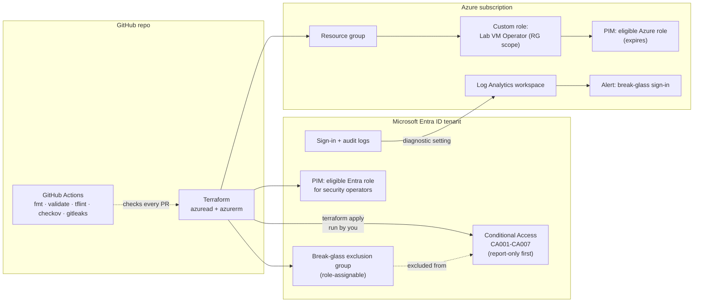

# Entra ID Identity Hardening as Code

Baseline Microsoft Entra ID identity controls (Conditional Access, break-glass
exclusions, least-privilege RBAC, PIM eligibility, and sign-in/audit log
export) written in Terraform so they can be reviewed, versioned, tested, and
rolled back like any other code.

> **Status: lab project, not yet deployed.** The Terraform code passes
> `terraform fmt`, `terraform validate`, `tflint`, and `checkov` locally (see
> [What has been validated](#what-has-been-validated)). It has **not** been
> applied to a tenant yet. Everything under *Deploy* and *Validate* is
> **untested. Deploy it yourself** in a lab tenant and record your own results.

---

## Problem

Identity is the control plane for cloud environments. Most tenant compromises
start with a stolen or phished credential, then escalate through standing
admin rights that nobody reviews. Click-ops configuration makes it worse:
Conditional Access policies drift, exclusions pile up without justification,
and there is no record of who changed what or why.

## Approach

| Principle | How this project applies it |
|---|---|
| Verify explicitly | MFA for everyone, phishing-resistant MFA for admins, MFA for Azure management, legacy auth and device-code flow blocked |
| Least privilege | Custom Azure role scoped to one resource group. Security operators get *eligible* (not standing) roles through PIM |
| Assume breach | Every Entra sign-in/audit log goes to Log Analytics. Break-glass sign-ins raise an alert. Runbooks cover compromised admins |
| Safe change | All Conditional Access policies deploy in **report-only** mode first and are promoted on purpose |
| Never lock yourself out | Every policy excludes a role-assignable break-glass group |

## Architecture



More detail, including the trust boundaries, is in
[docs/architecture.md](docs/architecture.md).

### What gets created

| File | Resources | License needed |
|---|---|---|
| `conditional_access.tf` | CA001 MFA for all users, CA002 block legacy auth, CA003 phishing-resistant MFA + 4h sign-in frequency for admin roles, CA004 MFA for Azure management, CA005 block device code flow, CA006/CA007 sign-in and user risk (optional) | Entra ID P1; P2 for CA006/CA007 |
| `groups.tf` | Break-glass exclusion group, PIM security-operators group, VM-operators group | Role-assignable groups need P1 |
| `pim.tf` | Eligible Entra role for security operators, eligible Azure role (expires after 30 days) | Entra ID P2 or Entra ID Governance |
| `rbac.tf` | Resource group, custom "Lab VM Operator" role, read-only Log Analytics Reader assignment | None beyond Azure |
| `logging.tf` | Log Analytics workspace (1 GB/day cap, local auth disabled), Entra diagnostic setting, break-glass sign-in alert, optional email action group | P1/P2 to export sign-in logs |
| `queries/` | KQL for report-only impact, legacy auth usage, risky sign-ins, privileged changes, break-glass use | — |

## Prerequisites

1. **A dedicated lab tenant.** Don't run this in a production or employer
   tenant. Create a new Entra tenant from the Azure portal, or use a trial.
2. **Licensing.**
   - **Microsoft Entra ID P1** is the minimum for Conditional Access.
   - **Microsoft Entra ID P2** is needed for PIM (`enable_pim`) and
     risk-based policies (`enable_risk_based_policies`).
   - Free option: activate the Entra ID P2 (or Microsoft 365 E5) free trial
     from the Microsoft Entra admin center or Microsoft 365 admin center.
     Trial terms and eligibility change. Check them before you start, and set
     a reminder to cancel before it converts to paid.
3. **An Azure subscription** in the same tenant (an Azure free account works)
   for the resource group and Log Analytics workspace.
4. **Two break-glass accounts** you create by hand first. See
   [docs/runbook.md](docs/runbook.md#3-break-glass-emergency-access).
5. **Permissions for whoever runs `terraform apply`:** Conditional Access
   Administrator and Privileged Role Administrator (or Global Administrator in
   a lab), Security Administrator for the Entra diagnostic setting, and Owner
   (or User Access Administrator + Contributor) on the subscription.
6. **Tools:** Terraform >= 1.9 (developed with 1.17.0), Azure CLI, and
   optionally tflint, checkov, and gitleaks for local checks.

## Setup and deploy (untested, deploy it yourself)

```bash
# 1. Sign in to the LAB tenant
az login --tenant <lab-tenant-id>
az account set --subscription <lab-subscription-id>

# 2. Configure variables (terraform.tfvars is git-ignored)
cp terraform.tfvars.example terraform.tfvars
#    fill in tenant_id, subscription_id, break_glass_user_object_ids

# 3. Static checks (the same ones CI runs)
terraform fmt -check -recursive
terraform init
terraform validate
tflint --init && tflint
checkov -d . --framework terraform --compact

# 4. Plan, read it carefully, then apply
terraform plan -out tfplan
terraform apply tfplan
```

**Rollout order that keeps you safe:**

1. Apply with `ca_policy_state = "enabledForReportingButNotEnforced"` (the default).
2. Let it run for at least a few days of normal sign-ins. Run
   `queries/ca-report-only-impact.kql` and `queries/legacy-auth-usage.kql`.
3. Use the Conditional Access **What If** tool to test a break-glass account
   and a normal user.
4. Switch to `ca_policy_state = "enabled"`, `plan`, `apply`.
5. Only after the P2 trial is active, set `enable_pim = true` and
   `enable_risk_based_policies = true`.

For anything beyond a personal lab, store state in a remote backend (Azure
Storage with Entra auth and versioning) and never commit `*.tfstate`.

## Validate (steps for you to run; no results are claimed here)

| # | Check | How |
|---|---|---|
| 1 | Policies exist and are report-only | Entra admin center → Protection → Conditional Access, or `az rest --method get --url https://graph.microsoft.com/v1.0/identity/conditionalAccess/policies --query "value[].{name:displayName,state:state}" -o table` |
| 2 | Break-glass accounts are excluded | What If tool with a break-glass account should show no CA00x policies applying |
| 3 | Legacy auth would be blocked | Sign-in logs → filter Client app = "Other clients". `CA002` result should be `reportOnlyFailure` |
| 4 | Admin policy targets the right roles | What If with a test user holding Security Administrator should show `CA003` |
| 5 | Logs are flowing | In Log Analytics run `SigninLogs | take 10` and `AuditLogs | take 10` (can take 15+ minutes after setup) |
| 6 | Break-glass alert fires | Sign in once with a break-glass account, check Azure Monitor → Alerts within ~10 minutes, then follow the runbook to document the test |
| 7 | PIM eligibility (P2) | Sign in as a member of the security-operators group → My roles → Eligible. Activate, then confirm it appears in `queries/privileged-role-changes.kql` |
| 8 | Custom role is least privilege | `az role definition list --custom-role-only true --query "[].{name:roleName,actions:permissions[0].actions}"`, then confirm a group member can start/stop but **not** delete a VM |

Record what you actually observed (screenshots with tenant IDs redacted, query
output) under a `results/` folder before calling the lab "done."

## Teardown

```bash
# Set policies to disabled first if you want a two-step rollback
terraform destroy
```

Then remove manually created items: the break-glass accounts (if this was a
throwaway tenant), any test users, and the trial licenses. Deleted Entra
groups sit in the recycle bin for 30 days. Check the Entra admin center
afterward for any leftover `idlab-*` objects.

## Cost notes

- **Entra licensing** is the main cost. The trial is free for its term. After
  that it's billed per user per month.
- **Log Analytics** bills per GB ingested and for retention past the included
  period. A small lab tenant produces little sign-in data, and
  `log_daily_quota_gb = 1` caps ingestion. Check the current
  [Azure Monitor pricing](https://azure.microsoft.com/pricing/details/monitor/)
  page for your region.
- **Alert rules** have a small monthly charge per rule. Conditional Access,
  groups, custom roles, and PIM configuration don't add Azure charges.
- Run `terraform destroy` when you're done.

No cost figures are stated here because none have been measured.

## Exam objective mapping

Microsoft retired **AZ-500** on August 31, 2026. It was replaced by
**SC-500: Implementing End-to-End Security Controls for Cloud and AI
Workloads** (Microsoft Certified: Cloud and AI Security Engineer Associate).
The table maps to the current SC-500 skills outline, with the legacy AZ-500
objective for reference. The Zero Trust and privileged-access design also
supports **SC-100** (see the companion reference architecture repo).

| Lab component | SC-500 skill (current) | Former AZ-500 objective |
|---|---|---|
| CA001-CA007 | Implement conditional access policies | Implement Conditional Access policies for cloud resources in Azure |
| CA001, CA003, CA004, auth strength | Implement and configure authentication methods, including MFA and passwordless | Implement MFA for access to Azure resources |
| `pim.tf` | Implement and configure Privileged Identity Management (PIM) | Plan and manage Azure resources in Microsoft Entra PIM |
| `rbac.tf` custom role | Manage custom roles, including Azure roles and Microsoft Entra roles | Manage custom roles, including Azure roles and Microsoft Entra roles |
| `rbac.tf` Log Analytics Reader | Manage Azure built-in role assignments | Manage Azure built-in role assignments |
| Whole repo + CI | Implement and configure security controls by using infrastructure as code | — |
| `logging.tf`, `queries/` | Create and connect workspaces in Microsoft Sentinel (workspace foundation); Configure and use Microsoft data connectors | Configure data connectors in Microsoft Sentinel |

Sources: [SC-500 study guide](https://learn.microsoft.com/credentials/certifications/resources/study-guides/sc-500),
[AZ-500 study guide (retired)](https://learn.microsoft.com/credentials/certifications/resources/study-guides/az-500).

## What has been validated

Run locally on the authoring machine, with no Azure credentials and no tenant:

| Check | Tool / version | Result |
|---|---|---|
| Formatting | `terraform fmt -check -recursive` (Terraform 1.17.0) | Pass |
| Init | `terraform init -backend=false` (azuread 3.10.x, azurerm 5.10.x) | Pass |
| Schema validation | `terraform validate` | Pass |
| Lint | `tflint` 0.65.0 + azurerm ruleset 0.32.0 | Pass (0 issues) |
| IaC policy scan | `checkov` 3.3.30 | Pass. Note that only 1 checkov check applies to these resource types, so this is a light signal |
| Secret scan | `gitleaks` 8.30.1 (`gitleaks dir` on the working tree and `gitleaks git` on the commit history) | No leaks found |

`validate` checks syntax and provider schemas only. It does **not** prove the
policies behave as intended. That needs `plan`/`apply` and the validation
steps above in a real tenant.

## Limitations

- **Not deployed.** No plan or apply has been run against a tenant.
- Break-glass accounts are created by hand on purpose so their credentials
  never touch Terraform state. Terraform only manages the exclusion group.
- CA003 uses the built-in *Phishing-resistant MFA* authentication strength.
  Admins need a passkey/FIDO2 key, Windows Hello for Business, or
  certificate-based auth registered **before** you enforce it.
- No device-compliance policies, because those need Intune. Session controls
  through Defender for Cloud Apps aren't included either.
- CA006/CA007 use the classic "require MFA / password change" grants.
  Microsoft's guidance on risk remediation keeps evolving, so check the
  current recommendation before enforcing them.
- Local state by default. Use a remote backend with locking for shared use.
- Terraform state contains object IDs and policy configuration. Treat it as
  sensitive.

## Repo layout

```
.
├── conditional_access.tf   # CA001-CA007
├── groups.tf               # break-glass exclusion + PIM/RBAC groups
├── pim.tf                  # eligible Entra + Azure role assignments (P2)
├── rbac.tf                 # resource group, custom role, scoped built-in role
├── logging.tf              # Log Analytics, Entra diagnostic setting, alert
├── locals.tf / variables.tf / outputs.tf / providers.tf / versions.tf
├── terraform.tfvars.example
├── queries/                # KQL for validation and investigations
├── docs/
│   ├── architecture.md
│   ├── threat-model.md
│   └── runbook.md
└── .github/workflows/ci.yml
```

## License

MIT. See [LICENSE](LICENSE).
