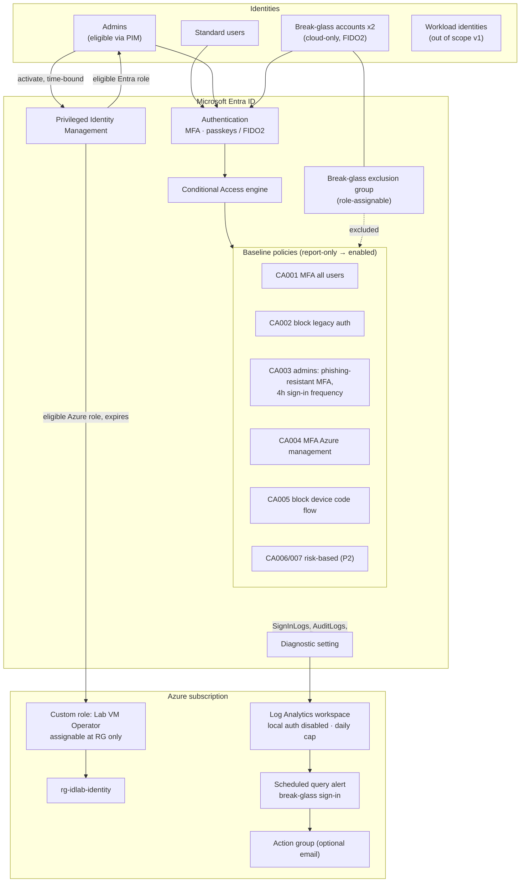

# Architecture

## Scope

This lab hardens the **identity control plane** of a single Microsoft Entra
tenant and the Azure subscription attached to it. It's the identity-pillar
implementation of the companion *Azure Zero Trust Reference Architecture*.

## Components and data flow

## Trust boundaries

| Boundary | What crosses it | Control |
|---|---|---|
| Internet → Entra sign-in | Credentials, tokens | CA001-CA005, auth strengths, risk policies |
| Standard → privileged | Role activation | PIM eligibility, phishing-resistant MFA (CA003), audit log |
| Entra → Azure RBAC | Role assignments | Custom role scoped to one RG, PIM eligibility that expires |
| Entra → Log Analytics | Log export | Diagnostic setting (Security Administrator required), workspace with local auth disabled |
| Engineer → tenant (IaC) | `terraform apply` | Human-run apply, CI static checks, git history as change record |

## Design decisions

| Decision | Why | Trade-off |
|---|---|---|
| Report-only by default | Shows impact before anything is enforced, so no surprise lockouts | Nothing is protected until you promote the policies |
| Break-glass accounts **not** created by Terraform | Keeps their credentials out of state and plan output | Manual step, documented in the runbook |
| Exclude a **group**, not individual users | One place to audit, and role-assignable groups resist tampering | Group membership changes must be monitored |
| Role template IDs hard-coded in `locals.tf` | Same in every tenant, verified against Microsoft docs, readable in review | Must be updated if Microsoft adds roles you want to cover |
| Built-in "Phishing-resistant MFA" strength for admins | Matches MCSB IM-6 guidance and resists AiTM phishing | Admins must enroll passkeys/FIDO2 first |
| Log Analytics with `local_authentication_enabled = false` | Forces Entra-authenticated access to logs | Older tooling that relies on workspace keys won't work |
| Daily ingestion cap | Bounded lab cost | Logs dropped past the cap. Raise it for anything real |

## Out of scope (candidates for v2)

- Workload identity protection (service principal CA, workload ID premium)
- Device compliance (Intune) and token protection
- Entitlement management / access reviews (Entra ID Governance)
- Microsoft Sentinel analytics rules on top of the workspace
- Authentication methods policy (disable SMS/voice) as code
